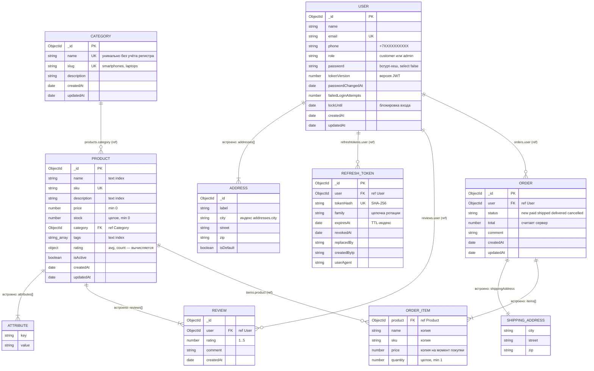

# Модель данных: интернет-магазин электроники

База `shop_secure_db`, 5 коллекций: **categories**, **products**, **users**, **orders**, **refreshtokens**.

Что добавлено для безопасности: в `users` — `password` (bcrypt-хеш), `tokenVersion`, `passwordChangedAt`, `failedLoginAttempts`, `lockUntil`; новая коллекция `refreshtokens` (сессии). Подробно — [security.md](security.md).

## ER-диаграмма

Та же диаграмма отдельным файлом для отчёта: [er-diagram.svg](er-diagram.svg).

Сплошные связи — ссылки (`ObjectId` + `ref`, в API подтягиваются через `populate`).
Сущности с пометкой «встроено» хранятся **внутри** документа-родителя, отдельной коллекции у них нет.



## Embedding или referencing — где что и почему

| Данные | Способ | Почему |
|---|---|---|
| `products.category` → categories | **ссылка** | Категория — отдельная сущность, одна на много товаров (1:N). Переименование категории не должно требовать правки всех товаров. Категории нужны и без товаров (меню каталога). |
| `orders.user` → users | **ссылка** | У пользователя заказов может быть сколько угодно (неограниченный рост). Если встроить заказы в пользователя, документ будет расти до лимита 16 МБ. |
| `users.addresses[]` | **встраивание** | Адресов мало (ограничение 5), без пользователя смысла не имеют, читаются всегда вместе с профилем — один запрос вместо двух. |
| `products.reviews[]` | **встраивание** + ссылка на автора | Отзывы показываются на странице товара вместе с ним; принадлежат одному товару. Количество ограничено (200 на документ). Если бы отзывов были тысячи — вынесли бы в отдельную коллекцию `reviews`, а в товаре оставили бы только последние 10 (subset pattern). |
| `products.attributes[]` | **встраивание** (attribute pattern) | У разных категорий разные характеристики (у ноутбука — процессор, у наушников — шумоподавление). Пары «ключ–значение» вместо десятков полей. |
| `orders.items[]` | **встраивание** + ссылка на товар + **копия** name/sku/price | Позиции — часть заказа, отдельно не живут. Цена копируется (snapshot pattern): заказ должен хранить цену покупки, даже если товар потом подорожал или удалён. Ссылка `product` оставлена, чтобы перейти к актуальному товару. |
| `orders.shippingAddress` | **встраивание (копия)** | Адрес фиксируется на момент заказа: если покупатель сменит адрес в профиле, уже отправленный заказ не должен «переехать». |
| `products.rating` | **вычисляемое поле** (computed pattern) | Средняя оценка пересчитывается при изменении отзывов, а не при каждом чтении; по ней можно сортировать и строить индекс. |

**Правило, которым руководствовались:** встраиваем то, что читается вместе с родителем, принадлежит только ему и не растёт бесконечно; ссылаемся на то, что является самостоятельной сущностью, используется многими документами или растёт без ограничений.

## Индексы

| Коллекция | Индекс | Зачем |
|---|---|---|
| categories | `slug_1` (unique) | Поиск по slug, уникальность |
| categories | `name_unique_ci` (unique, collation ru, strength 2) | «Аудио» и «аудио» — дубликат |
| products | `sku_1` (unique) | Уникальный артикул |
| products | `product_text` (text: name×10, tags×5, description×1, язык russian) | Полнотекстовый поиск `?q=` с русской морфологией |
| products | `category_1_price_1` | Каталог категории с фильтром/сортировкой по цене |
| products | `rating.avg_-1` | Сортировка по рейтингу |
| users | `email_1` (unique) | Вход/поиск по email, уникальность |
| users | `role_1` | Фильтр `?role=` |
| users | `addresses.city_1` (multikey) | Фильтр по полю встроенного массива `?city=` |
| orders | `user_1_createdAt_-1` | История заказов пользователя, новые сверху |
| orders | `status_1_createdAt_-1` | Заказы по статусу |
| refreshtokens | `tokenHash_1` (unique) | Поиск сессии по хешу токена |
| refreshtokens | `family_1`, `user_1` | Отзыв цепочки при краже, «выйти везде» |
| refreshtokens | `expiresAt_1` (TTL, expireAfterSeconds: 0) | MongoDB сама удаляет истёкшие сессии |

**Почему сессии — отдельная коллекция, а не массив в users.** Токенов у пользователя может быть много (каждое устройство, каждая ротация), они постоянно добавляются и удаляются, а TTL-индекс работает только на уровне документов. Встраивание раздувало бы документ пользователя и не позволило бы MongoDB удалять просроченные сессии автоматически.

## Целостность данных (MongoDB сама её не проверяет)

- `Product.category` и `Order.user` — асинхронные валидаторы Mongoose проверяют, что документ, на который ссылаемся, существует.
- Удаление категории с товарами и пользователя с заказами запрещено (409 Conflict).
- Остаток списывается атомарно: `updateOne({ _id, stock: { $gte: qty } }, { $inc: { stock: -qty } })`. Если товара не хватило — откатываем уже списанное (компенсация). В продакшене это делают транзакцией (`session.withTransaction`), но транзакции требуют replica set, а учебный MongoDB — одиночный сервер.
- При отмене или удалении неотправленного заказа товары возвращаются на склад одной операцией `bulkWrite`.

## Пример документа `orders`

```json
{
  "_id": "6af564f15e046eeca4cfb7fe",
  "user": "6af564f15e046eeca4cfb7db",
  "items": [
    { "product": "6af564f15e046eeca4cfb7f5", "name": "Sony WH-1000XM5", "sku": "SONY-XM5", "price": 169990, "quantity": 1 }
  ],
  "shippingAddress": { "city": "Алматы", "street": "пр. Абая, 52, кв. 14", "zip": "050000" },
  "status": "paid",
  "total": 169990,
  "comment": "Позвонить за час до доставки",
  "createdAt": "2026-11-12T07:04:17.545Z",
  "updatedAt": "2026-11-12T07:04:17.545Z",
  "__v": 0
}
```
