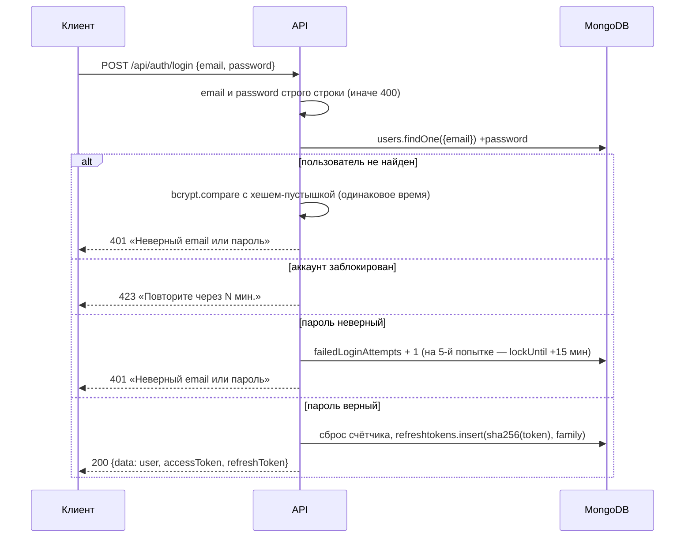
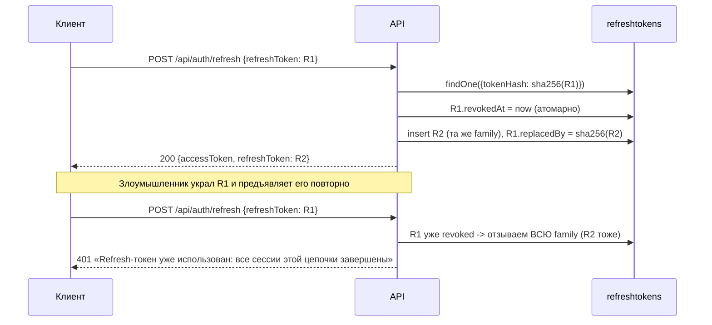

# Безопасность API: аутентификация, авторизация, защита

## 1. Схема аутентификации

Используются **два токена**:

| | Access-токен | Refresh-токен |
|---|---|---|
| Что это | JWT (HS256), подписан `JWT_ACCESS_SECRET` | Случайная строка 48 байт (base64url), не JWT |
| Срок жизни | 15 минут (`JWT_ACCESS_TTL`) | 7 дней (`REFRESH_TOKEN_TTL_DAYS`) |
| Где проверяется | В каждом защищённом запросе, без похода в БД за токеном | Только в `POST /api/auth/refresh` |
| Хранение на сервере | Не хранится (stateless) | В коллекции `refreshtokens` — только SHA-256-хеш |
| Отзыв | Через `tokenVersion` пользователя (смена пароля) или по истечении 15 мин | Пометка `revokedAt` (выход, ротация, кража) |
| Как передаётся | `Authorization: Bearer <token>` | В теле запроса `{ "refreshToken": "..." }` |

Payload access-токена:

```json
{ "role": "customer", "ver": 0, "iat": 1794470000, "exp": 1794470900,
  "aud": "shop-api-client", "iss": "shop-api", "sub": "6af564f15e046eeca4cfb7db" }
```

Персональных данных (email, телефон) в токене нет: JWT **подписан, но не зашифрован**, и его содержимое читается base64-декодированием.

### Вход



### Обновление токенов: ротация и обнаружение кражи



### Проверка access-токена (`src/middleware/auth.js`)

1. Заголовок `Authorization: Bearer <token>`, иначе 401.
2. `jwt.verify` с `algorithms: ['HS256']`, `issuer`, `audience`: отсекаются `alg: none`, подмена алгоритма, чужой ключ, токены других приложений и просроченные.
3. Пользователь `sub` существует сейчас (удалённый пользователь → 401).
4. `payload.ver === user.tokenVersion` (после смены пароля версия растёт → все старые токены → 401).
5. Роль берётся **из БД**, а не из токена: разжалованный админ теряет права сразу.

## 2. Авторизация: матрица доступа

| Ресурс | Гость | customer | admin |
|---|---|---|---|
| `GET` категорий, товаров, отзывов | ✅ | ✅ | ✅ |
| `POST/PATCH/DELETE` категорий и товаров | 401 | 403 | ✅ |
| `POST` отзыв | 401 | ✅ (автор = из токена) | ✅ |
| `PATCH/DELETE` отзыв | 401 | только свой, чужой → 403 | ✅ любой |
| `GET /api/orders`, `GET /api/orders/:id` | 401 | только свои (чужой → 404) | ✅ все |
| `POST /api/orders` | 401 | ✅ на себя (поле user игнорируется) | ✅ за любого |
| `PATCH /api/orders/:id` | 401 | свой: только `cancelled`, comment, адрес | ✅ любой статус |
| `DELETE /api/orders/:id` | 401 | 403 | ✅ |
| `/api/users` (CRUD) | 401 | 403 | ✅ |
| `/api/stats/*` | 401 | 403 | ✅ |
| `/api/auth/me`, `/password`, `/logout-all` | 401 | ✅ свой | ✅ свой |

**Почему чужой заказ — 404, а не 403.** Ответ 403 подтвердил бы, что заказ с таким id существует. Фильтр «только свои» (`scope` в `crudFactory`) добавляется прямо в запрос к MongoDB (`findOne({ _id, user: req.user.id })`), поэтому чужой документ для покупателя просто не существует. Это защита от **IDOR / BOLA** — уязвимости №1 в OWASP API Top 10.

## 3. Защитные меры и от чего они защищают

| Угроза | Мера | Где |
|---|---|---|
| Утечка базы → пароли | bcrypt, 12 раундов, соль внутри хеша; `select: false`; удаление из `toJSON` | `models/User.js` |
| Утечка базы → готовые сессии | refresh-токены хранятся как SHA-256-хеш | `models/RefreshToken.js` |
| Подбор пароля | Блокировка аккаунта на 15 мин после 5 неудач (423); rate limit 20 неудачных входов / 15 мин с IP (429) | `authController.login`, `middleware/security.js` |
| Перебор email (user enumeration) | Одинаковое сообщение и одинаковое время ответа для «нет пользователя» и «неверный пароль» | `authController.login` |
| Слабые пароли | Не короче 8, буква + цифра, не длиннее 72 (предел bcrypt) | `models/User.js` |
| Подделка JWT | Секрет ≥ 32 символов, иначе сервер не стартует; только HS256; проверка iss/aud/exp | `config.js`, `tokenService.js` |
| Кража refresh-токена | Ротация, обнаружение повторного использования → отзыв цепочки | `tokenService.rotateRefreshToken` |
| Утёкший access-токен после смены пароля | `tokenVersion` в JWT, отзыв всех refresh-токенов | `User.pre('save')`, `authController.changePassword` |
| Повышение привилегий (mass assignment) | Белые списки полей (`pick`): `role` нельзя задать при регистрации и в `/auth/me`; `user` в заказах и отзывах берётся из токена | контроллеры |
| IDOR / BOLA (доступ к чужим данным) | `scope` на уровне запроса к БД; проверка автора отзыва | `crudFactory`, `productController` |
| NoSQL-инъекции | Поля входа — строго строки; `sanitizeFilter`; фильтры строятся вручную с приведением типов; Express 5 не разбирает `?a[$ne]=` в объекты | `authController`, `utils/query.js` |
| ReDoS | Экранирование пользовательского ввода в `$regex` | `utils/query.js` |
| XSS, clickjacking, MIME-sniffing | Helmet: CSP, X-Frame-Options, X-Content-Type-Options, HSTS, Referrer-Policy | `middleware/security.js` |
| Запросы с чужих сайтов | CORS только для адресов из `CORS_ORIGINS` | `middleware/security.js` |
| DoS большими запросами | `express.json({ limit: '100kb' })` → 413; общий rate limit | `app.js` |
| Раскрытие технологий и деталей | Без `X-Powered-By`; при 500 — общее сообщение без стека; в логах нет тел запросов и токенов | `app.js`, `errorHandler.js` |
| Секреты в репозитории | `.env` в `.gitignore`, в репозитории только `.env.example` с заглушкой | `.gitignore` |
| Уязвимые зависимости | `npm audit` → 0 уязвимостей (12.11.2026) | — |

## 4. Соответствие OWASP API Security Top 10 (2023)

| № | Риск | Что сделано |
|---|---|---|
| API1 | Broken Object Level Authorization | `scope` (только свои заказы), проверка автора отзыва, 404 для чужих объектов |
| API2 | Broken Authentication | bcrypt, блокировка, rate limit, короткий access + ротация refresh, проверка alg/iss/aud |
| API3 | Broken Object Property Level Authorization | Белые списки полей на запись; `toJSON` скрывает password, tokenVersion и др. |
| API4 | Unrestricted Resource Consumption | Rate limit, лимит тела 100 КБ, `limit` пагинации ≤ 100 |
| API5 | Broken Function Level Authorization | `authorize('admin')` на управлении каталогом, пользователями, статистикой |
| API6 | Unrestricted Access to Sensitive Business Flows | Покупатель не может сам «оплатить» заказ; остаток списывается атомарно |
| API7 | SSRF | API не делает запросов по URL от клиента |
| API8 | Security Misconfiguration | Helmet, CORS allowlist, проверка секрета при старте, без X-Powered-By |
| API9 | Improper Inventory Management | Все маршруты описаны в README, Postman-коллекции и `requests.http` |
| API10 | Unsafe Consumption of APIs | Сторонние API не используются |

## 5. Что сделать при выходе в продакшен

- HTTPS (TLS) обязателен: без него Bearer-токен перехватывается в сети.
- Хранить refresh-токен в браузере в cookie `HttpOnly; Secure; SameSite=Strict`, а не в localStorage (защита от XSS).
- Хранилище rate limit — Redis вместо памяти процесса (несколько экземпляров сервера).
- Транзакции MongoDB (replica set) для заказа.
- Ротация `JWT_ACCESS_SECRET` и/или переход на RS256 (закрытый ключ только у сервера авторизации).
- Журнал событий безопасности: входы, блокировки, повторное использование refresh-токенов.
